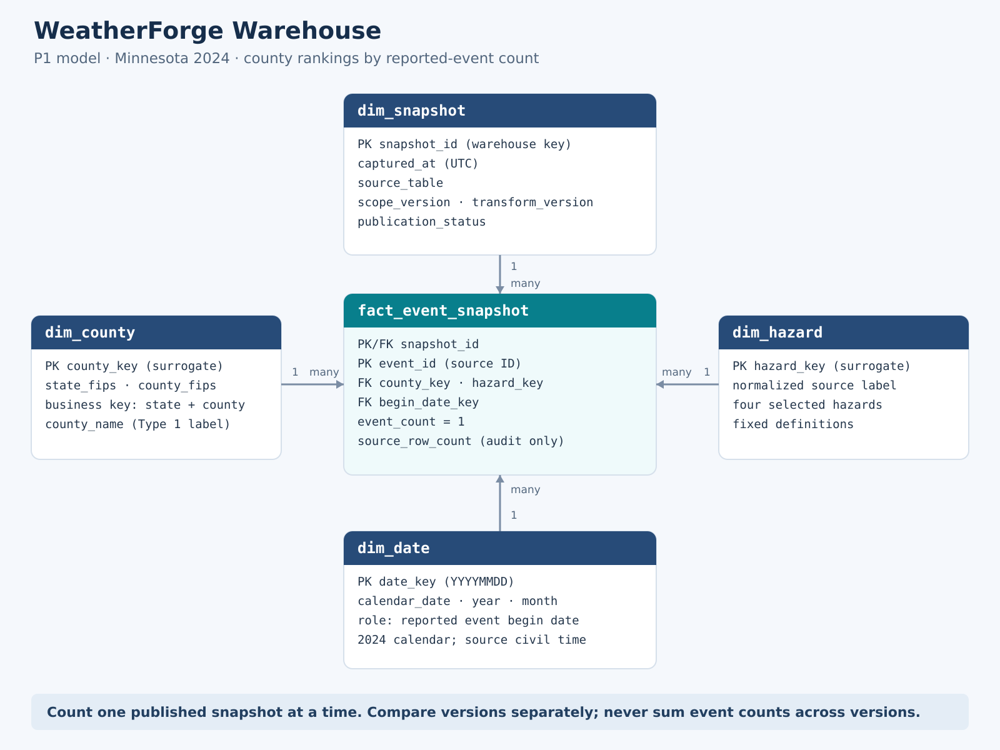

# P1 — Grain, Model, History & Pipeline Plan

**David Braun · SEIS 732 · October 28, 2026 (America/Chicago)**

**Draft for peer diagnosis.** P0 instructor approval and peer feedback remain pending. David selected the primary county-ranking question and requested both corrected totals and comparison with earlier versions. The choices below are a plan; no warehouse layers or historical captures have been built for P1.

**Artifacts:** [model diagram](model.svg) · [grain-check SQL](../sql/01_source_profile.sql) · [executed P0 SQL](../sql/00_feasibility.sql) · [recorded P0 evidence](../evidence/p0-feasibility-results.md).

## 1. Establish the question and check the source

### Audience, need, and scope

The audience is an insurance analyst responsible for catastrophe preparedness in Minnesota. The proposed task is to shortlist historical county–hazard–month cases for investigation or preparedness exercises. This is a classroom use-case hypothesis; insurer demand has not been validated.

**Primary question:** Which Minnesota counties had the most distinct reported events for a selected hazard in 2024?

**Supporting question:** How were those events distributed across the months of 2024? The same event facts and dimensions answer both questions.

Retain the P0 scope: Minnesota state FIPS 27, county-coded records (`cz_type = 'C'`), and hail, thunderstorm wind, tornado, and flash flood in the selected 2024 annual table. The new decision is to preserve captured versions so corrected county rankings can be compared with earlier rankings. Live alerts and claims forecasting remain longer-term WeatherForge goals. Counts describe reported events; they do not estimate insured risk, claims, or independent storm systems.

### Focused source profile

| Item | Source-supported description |
| --- | --- |
| Source object | `bigquery-public-data.noaa_historic_severe_storms.storms_2024` |
| Execution context | Existing course project `seis-732-david`; source/query location `US` |
| Source row meaning | A reported event can be repeated across location rows. Google's published importer left-joins event details to locations on `EVENT_ID`; an event can also have no matched location. |
| Candidate event identifier | Normalized `event_id`, interpreted within the fixed annual source object and selected population; `location_index` describes location detail and is not the analytical event key. |
| Relevant fields | `event_id`, `state_fips_code`, `cz_type`, `cz_fips_code`, `cz_name`, `event_type`, `event_begin_time`; retain `event_end_time` and `location_index` as Raw context. P0 verified their types. |
| Recorded size and coverage | October 21 P0: 85,896 annual source rows / 69,801 distinct IDs; selected population: 885 rows / 809 distinct IDs, 80 county codes, four hazards. Target begin times span April 16–September 21, 2024, across six months. |
| Material source issue | Repeated event IDs can inflate counts if source rows are counted as events. Source revisions can also change an event's classification. The annual table is not assumed immutable. |

Definitions come from [NOAA's bulk format](https://www.ncei.noaa.gov/pub/data/swdi/stormevents/csvfiles/Storm-Data-Bulk-csv-Format.pdf), [Google's importer](https://github.com/GoogleCloudPlatform/public-datasets-pipelines/blob/main/datasets/noaa/pipelines/_images/run_csv_transform_kub/csv_transform.py), and its [published schema](https://github.com/GoogleCloudPlatform/public-datasets-pipelines/blob/main/datasets/noaa/pipelines/noaa/data/noaa_historic_severe_storms_schema.json). Documentation explains the likely row structure; the recorded BigQuery outputs establish the observed counts. County codes have not yet been independently matched to a geographic reference.

### Observed grain check and conclusion

P1 reuses the **October 21, 2026 P0 Q3 execution**, job `job_LwSPvhnA3uM4nswg8PpO_ZlbG_vH`, in `seis-732-david` / `US`. The assignment permits reuse. Q1 in [01_source_profile.sql](../sql/01_source_profile.sql) reproduces its relevant expressions and maps its output names to the original result. This newly organized SQL has **not** been rerun in BigQuery.

| Check | Expectation for direct event-grain use | Observed P0 result |
| --- | --- | ---: |
| Eligible source rows | No predetermined total; establish a baseline | 885 |
| Distinct nonmissing event IDs | Equals row count if the source is already at event grain | 809 |
| Rows with missing event ID | 0 | 0 |
| Nonmissing ID groups with more than one source row | 0 if source rows can be loaded directly as event facts | 39 |
| ID groups with conflicting county-code / hazard / begin-time assignments | 0 | 0 |

**Decision:** Source rows are not at the required event grain. Preserve them in Raw, validate the attributes used for reporting, then produce one event fact per ID per capture. The 76 additional row occurrences are not automatically errors. For the recorded baseline, this rule is expected to yield 809 event facts; that output is a prediction, not an implemented result.

The observed zero-conflict result supports this choice within the selected population. It does not establish event-location uniqueness, county-name consistency, or ID consistency outside that population. SQL Q2 provides additional **unexecuted** diagnostics for those issues. Future captures must reconcile to their own eligible distinct-ID count; 809 is not a permanent acceptance threshold. An unresolved assignment conflict blocks publication rather than being resolved with an arbitrary row selection.

## 2. Define the model and predict a history consequence

### Process, grain, and keys

**Business process:** Record and summarize reported severe-weather events for historical insurance-preparedness analysis.

**Fact type:** An event-level snapshot fact. Each successful capture preserves a complete version of event-detail facts; captures occur when the project runs an extraction, not on a promised daily schedule.

**Grain:** **One row represents one distinct eligible NOAA reported event, identified within the selected annual source table, as observed in one successfully completed warehouse capture.**

The logical identifier is `(snapshot_id, source_table, event_id)`. Because each snapshot identifies exactly one annual source table, the physical fact key is `(snapshot_id, event_id)`. `event_id` remains a source identifier; warehouse dimension keys identify shared reference rows.

| Planned object | Keys and important attributes |
| --- | --- |
| `dim_snapshot` | Warehouse `snapshot_id`; `captured_at` in UTC, `source_table`, `scope_version`, `transform_version`, `publication_status`. One capture has many event facts. |
| `dim_county` | Surrogate `county_key`; business key = validated two-digit state FIPS + three-digit county FIPS; `county_name` is a display label. Accept county-coded records only. |
| `dim_hazard` | Surrogate `hazard_key`; fixed normalized source label for each of the four selected hazards. |
| `dim_date` | `date_key` in YYYYMMDD form; date, calendar year, month number/name. Role: event's reported begin date. Populate the 2024 calendar. |
| `fact_event_snapshot` | Composite key above; county, hazard, and begin-date foreign keys; `event_count = 1`; optional `source_row_count` for audit. Every fact has exactly one matching row in each dimension. |

**Consequential choice:** Location detail stays in Raw. The county-ranking question does not need a location fact or a one-to-many location join in the reporting path. This keeps the event count correct while retaining source context for diagnosis. A later location feature would require its own validated grain.

**Question-to-model path:** Select one published snapshot and one hazard; join the fact to county and event-begin-date dimensions; filter calendar year 2024; sum `event_count` by county. Rank descending, give equal counts equal rank, and use county code for a stable display order. Adding month to the grouping answers the supporting question. Show all 12 months with zero *recorded* events where appropriate; that does not prove complete observation. County coverage is the source-represented set, not a claimed complete statewide reference list.

### History and shared meaning

| Changing meaning or attribute | Planned treatment | Reporting consequence |
| --- | --- | --- |
| Event's county, hazard, or begin date | Retain complete, immutable event snapshots. Store each capture's assignments in its fact rows. | Corrected totals can change while the earlier captured totals remain reproducible. |
| County display-name spelling | Type 1 label correction, with a stable county business key | Counts and county identity stay stable; exact historical label spelling is not promised. Geographic-boundary changes are outside this scope. |
| Hazard definitions and date rules | Fixed definitions for this model version | Old and new totals use the same counting rules. A rule change requires a new version and explicit reconciliation before comparison. |

Preserving an event's old county assignment requires history in the event facts. A Type 2 county dimension alone would not capture that reassignment.

The **event date** is `DATE(event_begin_time)` as recorded. NOAA describes these times as usually local standard time; P0 verified BigQuery `DATETIME`, which carries no timezone. Do not silently reinterpret them as UTC or apply daylight-saving conversion. The **capture timestamp** is a separate UTC observation time. It means when WeatherForge read the source, not when NOAA made a correction.

Current totals use **one latest successfully published complete capture** for the fixed source/scope/model version. Never choose a latest row separately for each event: that could retain removed events or mix captures. `event_count` is additive within one capture and **must not be summed across captures**.

For comparison, aggregate the earlier and newer captures separately, full-outer-join their county/hazard/month groups, fill missing aggregate counts with zero, and compute `new_count - old_count`. This preserves negative changes when a group disappears. A full annual Raw capture also supports investigating events that leave the Minnesota or hazard selection. Absence from a later source capture is not, by itself, proof of why a record disappeared.

### Bounded P3 behavior to implement and test

Use **synthetic** events E1, E2, and E3, all hail in the same month. Initially E1 belongs to Alpha County and E2/E3 to Beta. In a corrected capture, E3 belongs to Alpha. Give E3 two location rows in each Raw fixture to test event counting as well.

| Report version | Alpha County | Beta County | Total |
| --- | ---: | ---: | ---: |
| Earlier capture | 1 | 2 | 3 |
| Corrected capture | 2 | 1 | 3 |
| Difference | +1 | −1 | 0 |

The latest ranking reverses; the earlier ranking remains available. An overwrite-only approach would lose the earlier ranking, while immutable captures satisfy David's comparison requirement. By P3, execute this fixture and verify the counts, unchanged earlier result, and one contribution from E3 despite its two locations. Also verify that a record leaving scope produces a negative comparison and a failed capture never becomes current. These are planned tests, not observed NOAA revisions.

## 3. Plan the build and its checks

All identifiers below are **planned**, in the existing `seis-732-david` project and `US` location; none is claimed to exist.

| Layer | Planned objects | Responsibility |
| --- | --- | --- |
| Raw | `seis-732-david.wf_raw.storms_2024_capture` | Append a complete capture of the nine selected fields from the annual source, including out-of-scope rows, with `snapshot_id` and capture metadata. Preserve location repetitions; keep source rows out of Git. |
| Curated | `seis-732-david.wf_curated.dim_snapshot`, `dim_county`, `dim_hazard`, `dim_date`, `fact_event_snapshot` | Normalize and validate identifiers; apply the fixed scope; resolve consistent event-level projections; assign dimension keys; retain complete event snapshots. A failed capture stays unpublished. |
| Serving | `seis-732-david.wf_serving.v_county_hazard_month` and `v_current_county_hazard_month` | Aggregate by snapshot/county/hazard/month, then expose one latest published snapshot by default. Comparison selects two compatible published snapshots explicitly. |

**Preliminary run order:** Recheck schema and query estimates → register a pending capture → capture Raw in one completed query job → run scope/grain checks against that captured Raw → build dimensions and event facts → reconcile joins and Serving totals → mark the capture published. Compute checks from the captured data rather than independently rereading a changing source. An incomplete or failed run must not replace the current published version.

**Field trace:** Source `event_id` → unchanged Raw value → trim/cast to a nonblank Curated source ID → validate county/hazard/date consistency within that ID → one fact with `event_count = 1` → sum by county and selected hazard for one snapshot → displayed reported-event count. Preserve `source_row_count` separately; it is not the audience's event measure.

| Project risk | Planned check and expected result | Where / when |
| --- | --- | --- |
| Repeated locations, invalid assignments, or dimension joins distort counts | Zero missing scope fields, missing event IDs/begin dates, non-2024 target begin dates, invalid county-code formats, unresolved reporting-attribute conflicts, duplicate fact keys, or unmatched dimension keys. Each fact joins once per dimension; fact row count equals that capture's eligible distinct-ID count. Resolve exceptions before publishing; do not silently drop them. | Raw scope checks and Curated build/join checks, before publication |
| Comparing or combining incompatible versions misstates county activity | A current report uses exactly one published capture; county/hazard/month totals reconcile to that capture's facts. Both comparison captures have the same source, scope, and transformation definitions; full outer comparison retains disappeared groups. | Serving validation, before publication and when a comparison is requested |
| A correction destroys the earlier interpretation | The synthetic correction yields Alpha +1, Beta −1, statewide 0; earlier counts stay 1/2 and duplicated locations add no extra event. A failed capture is never current. | P3 controlled history test |

**Access and stewardship:** The traced `event_id` and selected meteorological fields are public and low-risk. The planned audience output contains aggregate counts; event IDs remain in Raw/Curated for traceability. Intended reader: the insurance analyst; warehouse owner/steward: David Braun. NOAA/NCEI is the source provider. Keep source extracts, credentials, and any future insurer-held claims or policy data out of the repository. Any future private insurance data requires a separate access decision.

**Largest remaining limitation:** One year's reported-event counts do not measure insured exposure, expected claims, or long-term weather risk. Version history begins with captures actually retained by this warehouse. The October 21 aggregate P0 results are evidence, not a recoverable event-level historical snapshot.

**First concrete P2 step:** In BigQuery, confirm the nine-field schema and run the focused checks with `US` location, a dry-run/validator estimate, and maximum bytes billed of 1,073,741,824 (or a lower documented course limit). Resolve any newly observed exceptions, then build the first complete Raw capture and its registry entry. Reuse its data for all downstream checks.

## 4. Diagnose and revise the plan

### Change memo and feedback status

| Input | Decision / revision |
| --- | --- |
| David's October 28 direction | Make county ranking for a selected hazard the primary question; retain monthly distribution as support. |
| David's history preference | Preserve complete captures and compare corrected versus earlier totals; add snapshot identity to the fact grain and reporting filters. |
| Instructor feedback | None received as reported by David; P0 remains pending. No approval conditions are invented. |
| Peer diagnosis | No feedback received yet. The draft is committed; record the actual feedback and resulting revisions here after diagnosis. |
| Feedback not adopted | None yet. The overwrite-only history alternative was rejected as a design choice because it cannot satisfy the requested comparison. |
| Main uncertainty | Additional ID/geography/location diagnostics have not run, and usefulness of the insurance scenario remains subject to instructor review. Record any resulting model change. |

### AI/tool accountability and verification

ChatGPT drafted the plan, model diagram, and focused SQL, checked primary source documentation, and reviewed consistency with P0 and the assignment. The numerical evidence is the existing October 21 BigQuery execution by Codex; this P1 preparation does not claim a fresh query, a real correction experiment, or implemented layers. Local checks of document links, diagram rendering, SQL structure, and the synthetic arithmetic support review but do not replace BigQuery execution.

David supplied the audience priorities and historical comparison decision and reports reviewing the artifacts. This draft does not claim that he personally ran the SQL. He remains responsible for explaining the event/location distinction, the snapshot grain, and why a report must select one capture.

**Submission status:** Draft for peer diagnosis. After actual peer feedback, update this memo with changes adopted, changes not adopted and why, and the remaining uncertainty; commit the revision. Ensure P1 files are on the repository branch the instructor will open, then submit the repository link and `docs/p1-plan.md` in Canvas. Instructor approval remains pending until an actual decision is received.
